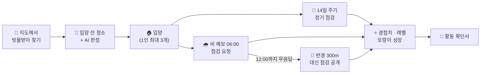
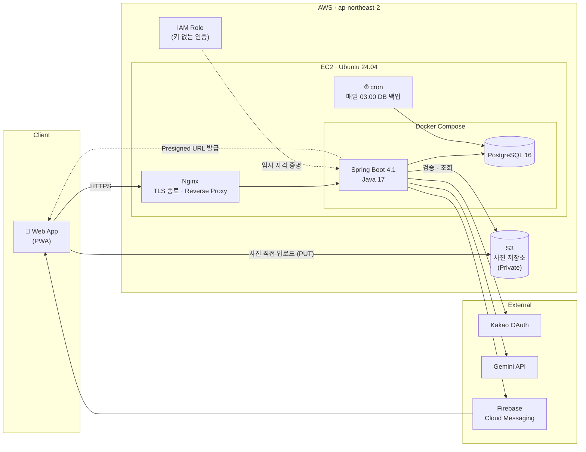
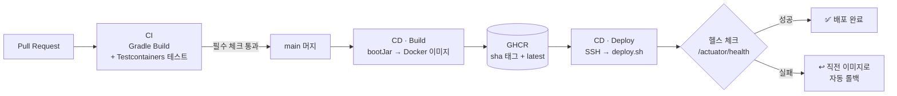
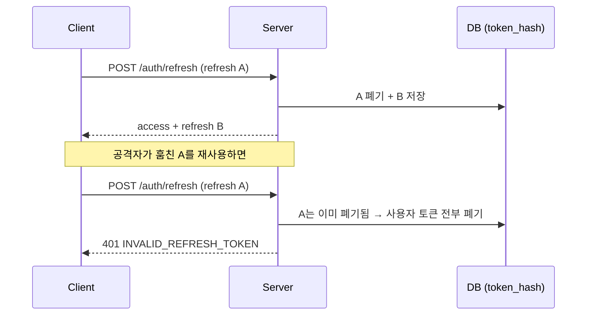
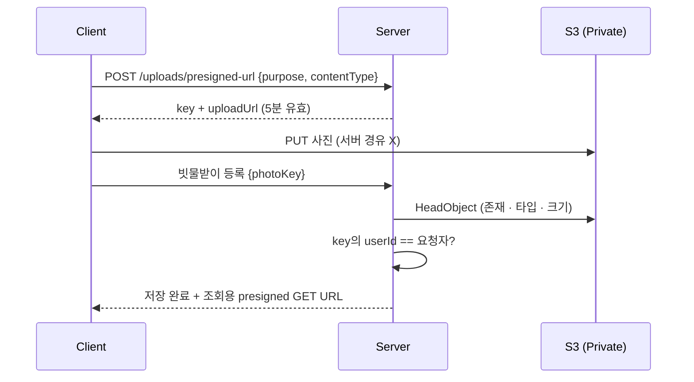
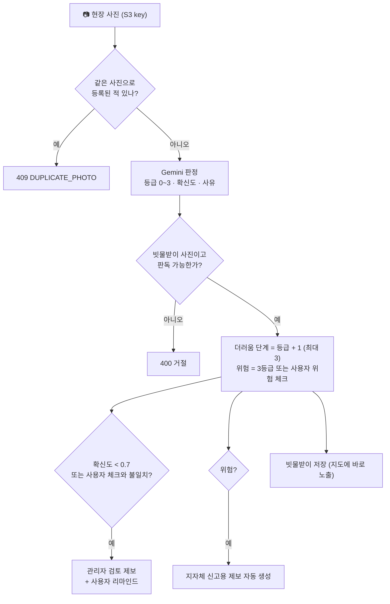

<div align="center">

# 🌧️ 빗물받이 집사 · Backend

**우리 동네 빗물받이를 시민이 입양해 돌보는, 시민 참여형 공공시설 관리 서비스**

막힌 빗물받이 하나가 골목 침수를 만듭니다.<br/>
빗물받이 집사는 시민이 가까운 빗물받이를 **입양**하고, **비 예보가 뜨면 미리 점검**하고,<br/>
**AI가 사진으로 상태를 판정**해 지자체 관리의 빈틈을 함께 메웁니다.

<br/>


<br/>

`https://api.rainbutler.site` · 파일럿 지역 **경기도 부천시 역곡동**

</div>

<br/>

## 📌 목차

1. [서비스 한눈에 보기](#-서비스-한눈에-보기)
2. [시스템 아키텍처](#-시스템-아키텍처)
3. [CI/CD 파이프라인](#-cicd-파이프라인)
4. [핵심 구현](#-핵심-구현)
5. [API](#-api)
6. [ERD](#-erd)
7. [프로젝트 구조](#-프로젝트-구조)
8. [로컬에서 실행하기](#-로컬에서-실행하기)
9. [개발 규칙](#-개발-규칙)
10. [Team](#-team)

<br/>

## 🗺️ 서비스 한눈에 보기



| 구분 | 내용 |
| --- | --- |
| **입양** | 시민이 빗물받이를 입양해 이름을 붙이고, 14일마다 점검합니다. 28일 미관리 시 경고, 35일이면 자동 해제됩니다. |
| **비 예보 점검** | 06:00 비 예보 알림 → 12:00까지 응답 → 20:00까지 청소. 응답이 없으면 반경 300m 이웃에게 대신 점검이 열립니다. |
| **AI 판정** | 현장 사진 한 장으로 더러움 단계와 위험 여부를 판정합니다. 확신이 낮거나 사용자 판단과 다르면 관리자 검토로 넘깁니다. |
| **공공성** | 약관 동의 · 본인인증 · 현장 안전 가이드를 거친 사용자만 공공시설 관리에 참여합니다. |

<br/>

## 🏗️ 시스템 아키텍처



- **사진은 서버를 거치지 않습니다.** 서버는 Presigned URL만 발급하고, 클라이언트가 S3에 직접 올립니다. 서버 부하와 트래픽 비용을 줄입니다.
- **AWS 액세스 키가 서버에 없습니다.** EC2 IAM Role의 임시 자격 증명으로 S3에 접근하고, 권한은 `prod/` 경로로만 제한합니다.
- **DB와 포트는 외부에 열지 않습니다.** 앱 · DB 모두 `127.0.0.1`에만 바인딩하고, 외부 진입점은 Nginx(443) 하나입니다.

<br/>

## 🚀 CI/CD 파이프라인



| 단계 | 내용 |
| --- | --- |
| **CI** | PR과 브랜치 push마다 빌드 · 테스트. 실제 PostgreSQL 컨테이너(Testcontainers)에 Flyway 마이그레이션과 JPA 검증까지 돌립니다. |
| **이미지** | 레이어 분리 Docker 빌드(`jarmode=tools extract`)로 의존성 레이어를 캐시하고, 커밋 SHA로 태그해 GHCR에 올립니다. |
| **배포** | `deploy.sh <sha>`가 새 이미지로 교체 후 헬스 체크를 기다리고, 실패하면 **직전 버전으로 자동 롤백**합니다. |
| **운영** | Let's Encrypt 자동 갱신 HTTPS, 매일 03:00 DB 백업(cron), 컨테이너 로그 로테이션, 메모리 상한 설정. |

<br/>

## 🔍 핵심 구현

### 🔐 인증 · 보안 &nbsp;<sub>by [@jongchanpark22](https://github.com/jongchanpark22)</sub>

**JWT는 직접 필터를 만들지 않고 Spring Security OAuth2 Resource Server로 처리합니다.**

- **Access Token**: HS256 JWT (30분). `NimbusJwtEncoder/Decoder`로 발급 · 검증하고, `role` 클레임을 권한으로 매핑합니다.
- **Refresh Token**: 추측할 수 없는 **불투명 토큰**. DB에는 **SHA-256 해시만** 저장해 DB가 유출돼도 토큰을 쓸 수 없습니다.
- **Refresh 회전 + 탈취 감지**: 재발급마다 새 토큰으로 바꾸고, **이미 폐기된 토큰이 다시 오면 그 사용자의 모든 세션을 끊습니다.**



- **카카오 로그인**: 인가 코드 방식. Client Secret은 서버에만 두고, `redirectUri`는 **허용 목록과 정확히 일치**할 때만 받아 오픈 리다이렉트를 막습니다.
- **역할 기반 인가**: `ADMIN` · `CITY_OFFICIAL` · `USER`. 인증 실패 · 권한 부족도 공통 응답 형식(`ApiResponse`)과 에러 코드로 내려갑니다.

### 📸 사진 업로드 (S3 Presigned URL) &nbsp;<sub>by [@jongchanpark22](https://github.com/jongchanpark22)</sub>



- DB에는 URL이 아닌 **S3 key만 저장**합니다. 버킷 · CDN이 바뀌어도 데이터를 고칠 필요가 없습니다.
- key에 업로더 ID를 넣어 **다른 사람의 사진을 가져다 쓰는 것을 차단**하고, 업로드 후 실제 타입 · 크기(10MB)를 다시 검증합니다.
- 서버가 임의 URL을 내려받던 구조를 없애 **SSRF 위험을 제거**했습니다.

### 🔔 푸시 알림 (FCM) &nbsp;<sub>by [@jongchanpark22](https://github.com/jongchanpark22)</sub>

- 알림은 **DB에 먼저 저장**하고, 푸시는 **트랜잭션 커밋 후 비동기**(`@TransactionalEventListener(AFTER_COMMIT)` + `@Async`)로 보냅니다. 푸시가 실패해도 업무 트랜잭션은 롤백되지 않습니다.
- FCM 응답에서 `UNREGISTERED` 토큰을 찾아 **자동으로 정리**합니다.
- 사용자 설정에 따라 알림을 끄거나, **야간(22~08시) 미동의자에게는 푸시 없이 알림함에만** 저장합니다.

### 📜 온보딩 · 약관 버전 관리 &nbsp;<sub>by [@jongchanpark22](https://github.com/jongchanpark22)</sub>

- 약관을 **버전별 행**으로 관리하고, 동의 · 철회를 **수정 없이 새 행으로 쌓는 이력 테이블**에 기록합니다. "누가 어떤 버전에 언제 동의했는지"가 남습니다.
- 약관 전문은 리소스 파일로 두고, **앱 시작 시 파일 존재를 검증**해 배포 사고를 막습니다.
- 온보딩(필수 약관 + 안전 가이드 + 본인인증)을 마친 사용자만 입양 · 점검 등 **공공시설 관리 기능**을 쓸 수 있도록 가드를 둡니다.
- 제재(허위 제보 1회 7일 · 2회 14일 · 3회 영구), 점검 쉬기(90일에 1회 14일), 회원 탈퇴(소프트 삭제 + 개인정보 익명화)까지 계정 생명주기를 다룹니다.

### 🗺️ 빗물받이 지도 · AI 판정 &nbsp;<sub>by [@jsh424](https://github.com/jsh424)</sub>

- **위치 기반 지도 조회**: 화면 영역(위도 · 경도 범위) 안의 빗물받이를 입양 상태 · 위험 여부와 함께 내려줍니다.
- **빗물받이 상세**: 현장 사진, 더러움 단계, 현재 입양 정보(이름 · 레벨 · 다음 관리일)를 한 번에 조회합니다.
- **Gemini 기반 사진 판정**: 사진 한 장으로 **등급(0~3) → 더러움 단계(1~3) · 위험 여부 · 확신도**를 판정합니다.



- 사용자가 위험이라고 체크하면 **AI 결과보다 사용자 판단을 우선**하고, **같은 사진의 재등록을 차단**합니다.
- 등록과 사진 판독 API가 **한 컴포넌트(`DrainAiClassifier`)를 공유**하고, 점검 · 청소 인증도 같은 기준을 쓰도록 설계해 어디서 찍어도 같은 판정이 나옵니다.
- API 키가 없으면 외부 호출 없이 기본값으로 동작해 **로컬 · CI 환경에서도 테스트가 깨지지 않습니다.**

### 🧱 데이터 · 코드 규칙

- **스키마는 Flyway만 바꿉니다.** JPA는 `ddl-auto: validate`로 엔티티와 테이블 일치만 검사합니다 (V1 ~ V7).
- 공통 `BaseEntity`(생성 · 수정 · 삭제 시각)와 **소프트 삭제**, Setter 없는 엔티티와 정적 팩토리로 상태 변경을 도메인 메서드에 모읍니다.
- 모든 응답은 `{ success, data, error }` 하나의 형식이고, 에러는 enum 코드로 내려가 프론트가 코드로 분기합니다.
- 운영 정책 값(주기 · 반경 · 마감 시각 · 쿨다운)은 코드 상수가 아닌 `PolicyProperties` 설정으로 관리합니다.

<br/>

## 📡 API

> 로컬 실행 후 Swagger UI: `http://localhost:8080/swagger-ui` &nbsp;·&nbsp; 운영에서는 Swagger를 노출하지 않습니다.

| 도메인 | 메서드 · 경로 | 설명 |
| --- | --- | --- |
| **Auth** | `POST /api/v1/auth/signup` · `login` | 자체 회원가입 · 로그인 |
| | `POST /api/v1/auth/kakao` · `GET /kakao/login-url` | 카카오 로그인 |
| | `POST /api/v1/auth/refresh` · `logout` | 토큰 재발급(회전) · 로그아웃 |
| **User** | `GET · PATCH · DELETE /api/v1/users/me` | 내 정보 · 닉네임 수정 · 탈퇴 |
| | `GET · PATCH /api/v1/users/me/settings` | 알림 설정 |
| | `GET · POST /api/v1/users/me/onboarding` | 온보딩 상태 · 완료 |
| | `GET · POST /api/v1/users/me/pause` | 점검 쉬기 |
| | `GET /api/v1/users/me/sanctions` | 제재 내역 |
| **Terms** | `GET /api/v1/terms` · `/{termsId}` | 약관 목록 · 전문 |
| **Drain** | `GET /api/v1/drain` | 지도 영역 빗물받이 목록 |
| | `GET /api/v1/drain/{drainId}` | 빗물받이 상세 |
| | `POST /api/v1/drain` | 빗물받이 등록 (AI 판정) |
| | `POST /api/v1/drain/assessments` | 사진 AI 판독 |
| **Upload** | `POST /api/v1/uploads/presigned-url` | 사진 업로드 URL 발급 |
| **Push** | `PUT · DELETE /api/v1/push/tokens` | FCM 토큰 등록 · 삭제 |
| **Health** | `GET /api/v1/health` | 헬스 체크 |

<details>
<summary><b>공통 응답 형식</b></summary>

```json
// 성공
{ "success": true, "data": { }, "error": null }

// 실패
{ "success": false, "data": null,
  "error": { "code": "ADOPTION_LIMIT_EXCEEDED",
             "message": "빗물받이는 최대 3개까지 입양할 수 있어요.",
             "fieldErrors": [] } }
```
</details>

<br/>

## 🧩 ERD

<p align="center">
  
</p>

> 테이블 설명과 설계 의도는 [`docs/erd/ERD.md`](docs/erd/ERD.md), 원본은 [`docs/erd/erd.dbml`](docs/erd/erd.dbml)에 있습니다.

<br/>

## 📁 프로젝트 구조

```
src/main/java/com/rainbutler
├── domain                     # 도메인별 entity · repository · service · controller · dto
│   ├── auth                   # 자체 · 카카오 로그인, JWT, refresh 토큰
│   ├── user                   # 내 정보, 설정, 온보딩, 쉬기, 탈퇴
│   ├── terms                  # 약관 · 동의 이력
│   ├── sanction               # 제재
│   ├── drain                  # 빗물받이 지도 · 상세 · 등록, Gemini AI 판정
│   ├── adoption · cleaning    # 입양 · 점검 · 청소
│   ├── request · forecast     # 비 예보 점검 요청
│   ├── push · notification    # FCM 토큰, 알림
│   ├── report · point · photo · toolbox
└── global
    ├── security               # Security 설정, JWT, 인증 실패 응답
    ├── storage                # S3 Presigned URL, StorageService
    ├── exception · response   # 공통 예외 · 응답
    ├── config · swagger · health

src/main/resources
├── db/migration               # Flyway V1 ~ V7
└── terms                      # 약관 전문 (버전별 markdown)

deploy
├── docker-compose.prod.yml    # 운영 app + db
├── nginx                      # 리버스 프록시 · TLS 설정
└── scripts                    # bootstrap-ec2 · deploy(헬스 체크 · 롤백) · backup-db
```

<br/>

## 🛠️ 로컬에서 실행하기

**필요한 것**: JDK 17, Docker

```bash
# 1. 로컬 DB (PostgreSQL 16)
docker compose up -d

# 2. 환경 변수 (값은 팀 채널에서 공유)
cp .env.local.example .env

# 3. 실행 (local 프로필)
./gradlew bootRun

# 4. 테스트 (Testcontainers가 PostgreSQL을 자동으로 띄웁니다)
./gradlew test
```

<details>
<summary><b>환경 변수</b></summary>

| 이름 | 설명 | 없으면 |
| --- | --- | --- |
| `JWT_SECRET` | JWT 서명 키 (Base64, 32바이트 이상) | 앱이 시작되지 않음 |
| `CORS_ALLOWED_ORIGINS` | 허용할 프론트 origin | `http://localhost:5173` |
| `KAKAO_CLIENT_ID` · `KAKAO_CLIENT_SECRET` | 카카오 REST API 키 · Secret | 카카오 로그인 불가 |
| `KAKAO_ALLOWED_REDIRECT_URIS` | 허용할 redirectUri 목록 | 로컬 기본값 |
| `S3_BUCKET` · `S3_REGION` · `S3_KEY_PREFIX` | 사진 버킷 · 리전 · 환경 prefix | 업로드 API만 비활성 |
| `S3_ACCESS_KEY` · `S3_SECRET_KEY` | 로컬 전용 (운영은 IAM Role) | 업로드 API만 비활성 |
| `FIREBASE_CREDENTIALS_BASE64` | FCM 서비스 계정 키 (Base64) | 푸시 발송만 생략 |
| `GEMINI_API_KEY` · `GEMINI_MODEL` | Gemini 키 · 모델 | AI 판정 기본값 사용 |

외부 서비스 키가 없어도 앱은 뜨고, 해당 기능만 비활성화됩니다.
</details>

<br/>

## 📏 개발 규칙

- **브랜치**: `main` 보호 · PR 머지만 허용 · CI 통과 필수. 작업 브랜치는 `feat/…`, `fix/…`, `refactor/…`, `chore/…`
- **커밋**: `feat:` `fix:` `refactor:` `test:` `chore:` `docs:` + 한국어 요약
- **DB**: 엔티티를 바꾸면 반드시 새 Flyway 버전 파일을 함께 올립니다. 머지된 마이그레이션은 수정하지 않습니다.
- **API**: 모든 경로는 `/api/v1` 아래, 실패는 `BusinessException(ErrorCode)`로 던지고 응답을 직접 만들지 않습니다.

<br/>

## 👥 Team

<table>
  <tr>
    <td align="center" width="50%">
      <a href="https://github.com/jongchanpark22">
        <br/>
        <b>박종찬</b><br/>
        <sub>@jongchanpark22</sub>
      </a>
      <br/><br/>
      <b>Backend Lead · Infra</b>
      <br/><br/>
      <sub>
        AWS 인프라 · CI/CD · Nginx · DB 설계(ERD)<br/>
        인증(JWT · 카카오) · S3 업로드 · FCM 푸시<br/>
        계정 도메인(온보딩 · 약관 · 설정 · 제재 · 쉬기 · 탈퇴)
      </sub>
    </td>
    <td align="center" width="50%">
      <a href="https://github.com/jsh424">
        <br/>
        <b>jsh424</b><br/>
        <sub>@jsh424</sub>
      </a>
      <br/><br/>
      <b>Backend · Drain & AI</b>
      <br/><br/>
      <sub>
        위치 기반 빗물받이 지도 조회 · 상세 조회<br/>
        빗물받이 등록 · Gemini AI 사진 판정<br/>
        사진 판독 API
      </sub>
    </td>
  </tr>
</table>

<br/>

<div align="center">
  <sub>🌧️ 비가 오기 전에, 우리 동네 빗물받이부터.</sub>
</div>
